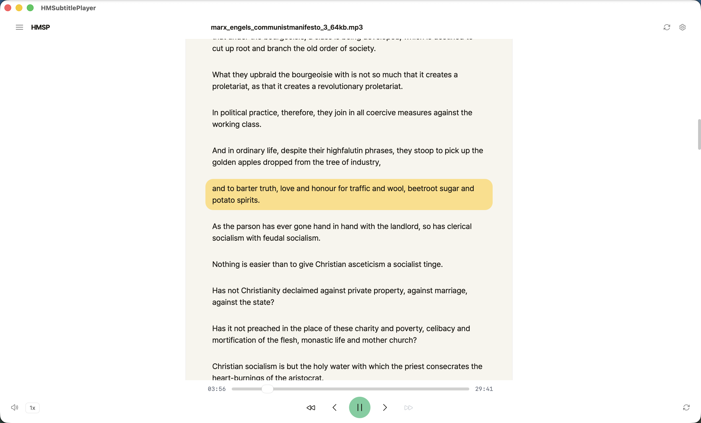
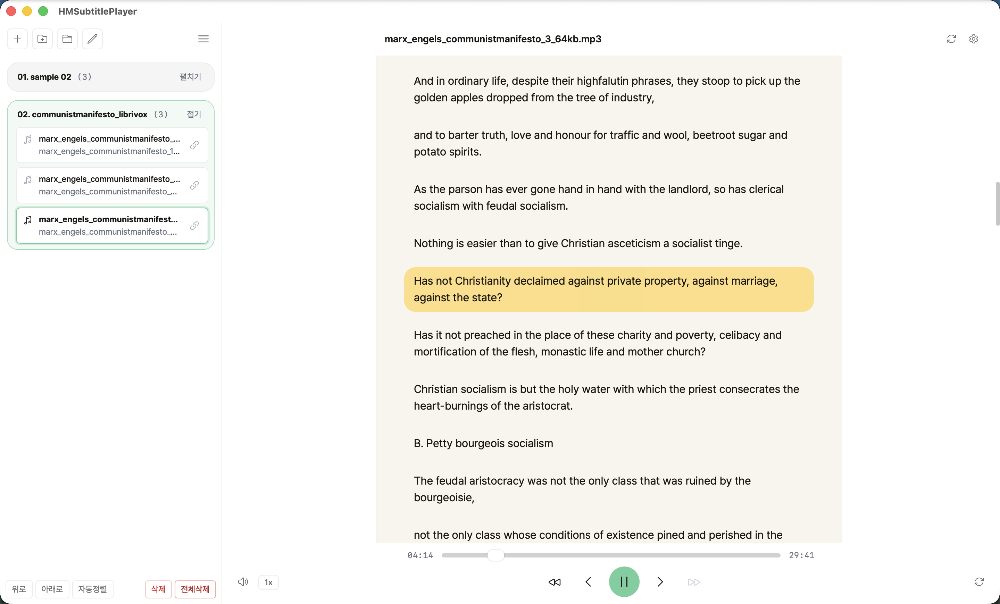
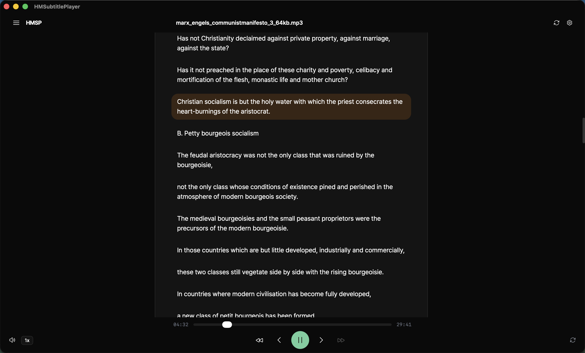
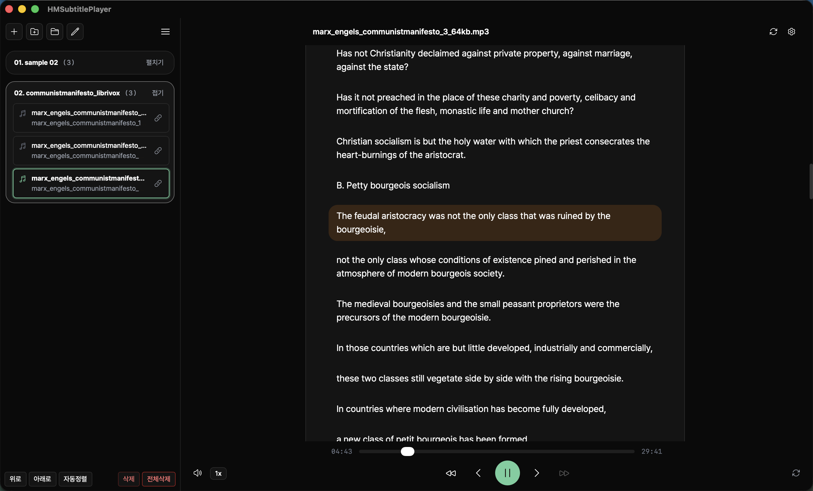
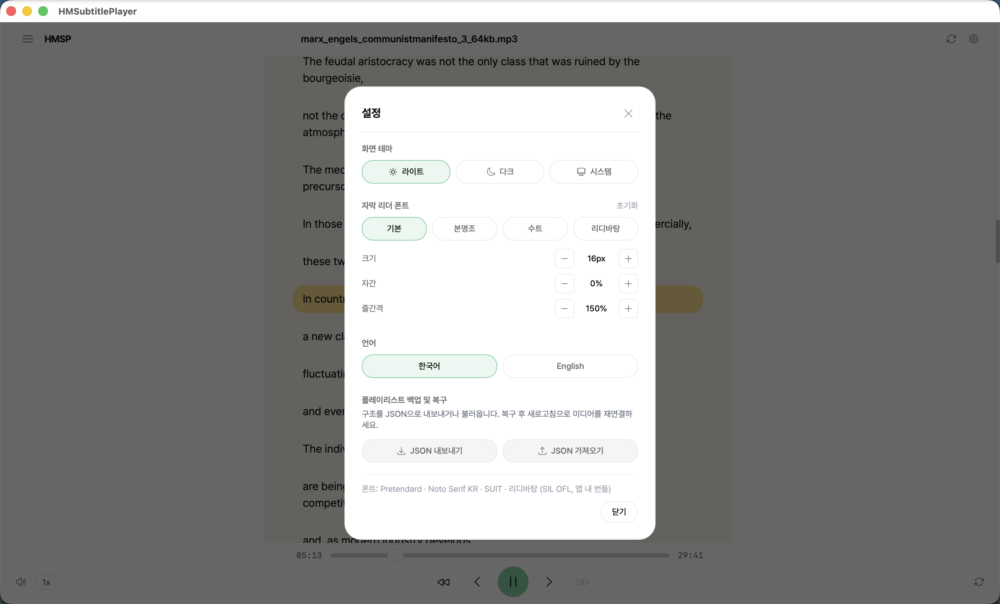

# HMSP — HMSubtitlePlayer (한국어 안내)

> 조금 모양이 다른 바퀴.

오디오북처럼 흘러가는 연속 문서 자막 리더 + 오디오 동기 재생 앱.

> English: [`readme.md`](./readme.md)



## 기능

- 폴더/파일 가져오기 — 드래그 앤 드롭 또는 파일 선택(오디오+자막 일괄)
- 연속 문서 리더: 자막 큐를 문단 흐름으로 렌더링하고, 재생 중인 문장만 강조합니다
  (나머지 문장은 흐리게 하지 않음)
- 문장 클릭 탐색 — 텍스트를 드래그로 선택한 경우에는 클릭 탐색이 발동하지 않습니다
- 자막 자동 연결(`name.vtt` 또는 `name.ext.vtt`, 대소문자 무시, 후보가 하나일 때만) + 수동 연결
- 현재 폴더 안에서 이전/다음 자막, 이전/다음 파일 이동
- 배속 0.5–1.5×, 볼륨, 한 곡 반복
- 리더 타이포그래피: 번들 폰트 4종(Pretendard, Noto Serif KR, SUIT, 리디바탕) + 크기·자간·줄간격 조절
- 테마(라이트/다크/시스템)와 UI 언어(한국어/영어)
- 파일이 옮겨졌을 때 새로고침 재연결(파일명 기반 2단계 매칭)
- JSON 플레이리스트 백업·복구
- 텍스트(`txt`) 동반 파일 — 리더 전용

## 지원 파일

| 종류 | 확장자 | 비고 |
|---|---|---|
| 오디오 | `wav` · `mp3` · `m4a` | 자막이 없거나 깨져 있어도 재생 |
| 자막 | `vtt` · `srt` | 파일명 후보가 하나일 때만 자동 연결 |
| 텍스트 | `txt` | 리더 전용 — 구간 탐색 없음 |

## 화면

| 라이트 서랍 | 다크 | 다크 서랍 | 설정 |
|---|---|---|---|
|  |  |  |  |

## 다운로드

[Releases](https://github.com/thusido/HMSP/releases)에서 받으세요.

| OS | 파일 |
|----|------|
| macOS (arm64) | `.dmg` |
| Windows (x64) | `-setup.exe` / `.msi` |
| Android (arm64) | `-signed.apk` |
| iPadOS | PWA `dist/` 아티팩트 (홈 화면에 추가 후 오프라인) |

무서명 테스트 빌드라서 첫 설치 때 안내가 뜹니다:

- **macOS**: Applications에 복사 후 **우클릭 → 열기**로 실행.
  그래도 "손상됨"이 뜨면 quarantine 해제 (직접 빌드한 앱에만 사용):
  `xattr -dr com.apple.quarantine /Applications/HMSubtitlePlayer.app`
- **Windows**: SmartScreen "알 수 없는 게시자"에서 **추가 정보 → 그래도 실행**.
- **Android**: 알 수 없는 출처의 앱 설치를 먼저 허용.

## 개발

준비물: Node LTS, pnpm 10, Rust stable(rustup — Homebrew cargo에는 Android 타겟이 없음).
Android는 Android Studio SDK가 추가로 필요합니다(아래 참고).

```bash
pnpm install
pnpm dev          # 웹 개발 서버 (:5173)
pnpm build        # 웹 / Tauri 프론트엔드 빌드
pnpm build:pwa    # PWA 빌드 — Service Worker가 포함되는 유일한 빌드 (VITE_PWA=true)
pnpm test         # vitest
pnpm tauri dev    # 데스크톱 셸
pnpm tauri build  # 데스크톱 설치본
pnpm icons        # 아이콘 파이프라인 (소스는 git 제외된 HMSP_user_icon/)
```

기술 스택: TypeScript, React 19, Vite 6, Tailwind CSS 3, Tauri v2, Vitest.
플랫폼 차이는 `src/services/platform/PlatformAdapter`에 격리되어 있고, Tauri 어댑터는
lazy-load되어 웹/PWA 번들에서 `@tauri-apps/*`가 제외됩니다.

각 단위마다 검증:

```bash
pnpm exec tsc -b
pnpm test
pnpm build
rg 'w-\[.*px\]|min-w-\[|text-\[[0-9]+px\]' src   # 비어 있어야 함 (flex-first 레이아웃)
```

### git에서 재현

`src-tauri/gen/`, `docs/`, `HMSP_user_icon/`은 의도적으로 git에서 제외됩니다.
클론 후:

```bash
pnpm install
pnpm tauri android init   # src-tauri/gen 재생성 (Android SDK 필요)
pnpm tauri icon <png>     # 전 플랫폼 아이콘 재생성 (Android mipmap 포함)
pnpm tauri android build  # 또는: pnpm tauri build (데스크톱)
```

Android 환경 (macOS + Android Studio SDK): `ANDROID_HOME=$HOME/Library/Android/sdk`,
`NDK_HOME=$ANDROID_HOME/ndk/<버전>`, JDK 17+; rustup stable 툴체인 사용
(Homebrew cargo에는 Android 타겟이 없음).

## 폰트 라이선스

번들 폰트는 프로젝트 라이선스와 별개로 **SIL Open Font License (OFL) version 1.1**을 따릅니다.
이 프로젝트에서 사용하는 모든 폰트는 OFL 1.1로 배포됩니다:

| 폰트 | 위치 | 라이선스 |
|---|---|---|
| Pretendard | `src/assets/fonts/pretendard/` | SIL OFL 1.1 |
| Noto Serif KR | `src/assets/fonts/noto-serif-kr/` | SIL OFL 1.1 |
| SUIT | `src/assets/fonts/suit/` | SIL OFL 1.1 |
| 리디바탕 (Ridibatang) | `src/assets/fonts/ridibatang/` | SIL OFL 1.1 |

전문은 [`public/SIL OFL 1.1.md`](./public/SIL%20OFL%201.1.md)에 있으며 빌드에도 함께 포함됩니다.
각 폰트 디렉터리에는 자체 `OFL.txt` / `LICENSE.txt`가 들어 있습니다.

## 라이선스

MIT — [LICENSE](./LICENSE) 참고.
